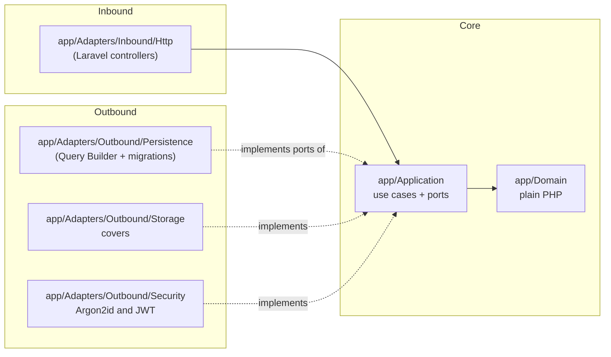
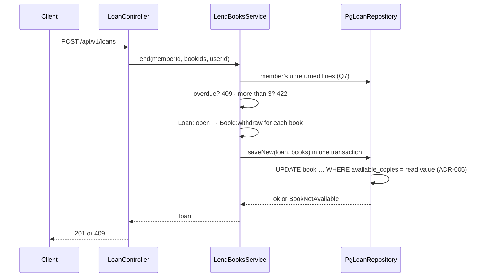

# Architecture — Manager Library (Laravel)

This is the same **hexagonal** architecture as [`../spec-python/architecture.md`](../spec-python/architecture.md), expressed with
Laravel conventions. The dependency rules (articles I to III) do not change.

## 1. Layers and dependencies



## 2. Folder structure (`api` repo)

```text
app/
├── Domain/              # Book, Loan, LoanItem, Member, User, LoanStatus; ValueObjects/; Exceptions/
├── Application/
│   ├── Ports/           # BookRepository, LoanRepository, MemberRepository, UserRepository,
│   │                    # ReportReader, Clock, PasswordHasher, TokenIssuer, CoverStorage
│   └── Services/        # one use case per class (LendBooksService, ReturnItemService, …)
├── Adapters/
│   ├── Inbound/Http/    # Controllers/, Middleware/ (JwtAuth, RequireRole), ErrorRenderer, Paginated
│   └── Outbound/        # Persistence/, Storage/, Security/, Clock/
├── Bootstrap/           # PortBindingsServiceProvider.php — the ONLY composition point (Art. III)
└── Console/             # BootstrapAdminCommand (initial admin from the environment)
database/migrations/     # all DDL (Art. V, ADR-001)
routes/api.php           # routes from api-contract.md §3
```

## 3. Laravel equivalents

| Spec concept | In Laravel |
|---|---|
| Port | `interface` in `app/Application/Ports` |
| Adapter | Class in `app/Adapters/Outbound/*` that implements the port |
| Composition | `PortBindingsServiceProvider::register()` with `$this->app->singleton(Port::class, Adapter::class)` |
| Global soft-delete filter | `activeBooks()` base query in `PgBookRepository` (`deleted_at IS NULL`) |
| Loan transaction | `DB::transaction()` inside the `PgLoanRepository::saveNew()` adapter |
| Domain errors → HTTP | `ErrorRenderer`, registered in `bootstrap/app.php` (`withExceptions`) |
| Role authorization | `role:admin,librarian` middleware |

**Eloquent is not used.** Its conventions (`created_at`, `updated_at`, auto-increment ids) contradict `data-model.md` §3, and it
would couple the domain to the ORM. The Query Builder lives only in the adapters.

## 4. Flow: registering a loan



## 5. What is not included

No events, queues, cache, Eloquent or Sanctum. As in the spec, these are added only if a requirement asks for them.
