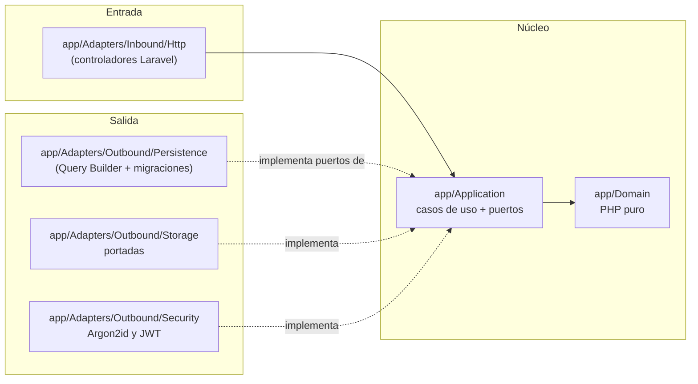
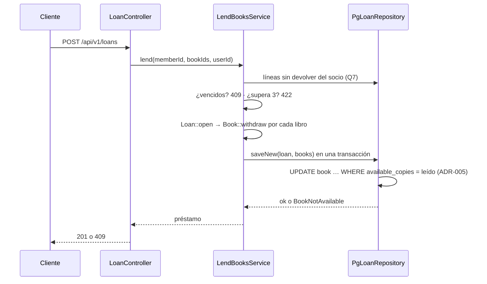

# Arquitectura — Manager Library (Laravel)

La misma arquitectura **hexagonal** de [`../spec-python/architecture.md`](../spec-python/architecture.md), expresada con las
convenciones de Laravel. Las reglas de dependencia (artículos I a III) no cambian.

## 1. Capas y dependencias



## 2. Estructura de carpetas (repo `api`)

```text
app/
├── Domain/              # Book, Loan, LoanItem, Member, User, LoanStatus; ValueObjects/; Exceptions/
├── Application/
│   ├── Ports/           # BookRepository, LoanRepository, MemberRepository, UserRepository,
│   │                    # ReportReader, Clock, PasswordHasher, TokenIssuer, CoverStorage
│   └── Services/        # un caso de uso por clase (LendBooksService, ReturnItemService, …)
├── Adapters/
│   ├── Inbound/Http/    # Controllers/, Middleware/ (JwtAuth, RequireRole), ErrorRenderer, Paginated
│   └── Outbound/        # Persistence/, Storage/, Security/, Clock/
├── Bootstrap/           # PortBindingsServiceProvider.php — ÚNICO punto de composición (Art. III)
└── Console/             # BootstrapAdminCommand (admin inicial desde entorno)
database/migrations/     # todo el DDL (Art. V, ADR-001)
routes/api.php           # rutas de api-contract.md §3
```

## 3. Equivalencias con Laravel

| Concepto del spec | En Laravel |
|---|---|
| Puerto | `interface` en `app/Application/Ports` |
| Adaptador | Clase en `app/Adapters/Outbound/*` que implementa el puerto |
| Composición | `PortBindingsServiceProvider::register()` con `$this->app->singleton(Port::class, Adapter::class)` |
| Filtro global de baja lógica | Consulta base `activeBooks()` en `PgBookRepository` (`deleted_at IS NULL`) |
| Transacción de préstamo | `DB::transaction()` dentro del adaptador `PgLoanRepository::saveNew()` |
| Errores de dominio → HTTP | `ErrorRenderer` registrado en `bootstrap/app.php` (`withExceptions`) |
| Autorización por rol | Middleware `role:admin,librarian` |

**Eloquent no se usa**: sus convenciones (`created_at`, `updated_at`, ids autoincrementales) contradicen `data-model.md` §3 y
acoplarían el dominio al ORM. El Query Builder vive solo en los adaptadores.

## 4. Flujo: registrar un préstamo



## 5. Qué no hay

Sin eventos, colas, caché, Eloquent ni Sanctum. Igual que el spec: se añaden si un requisito lo pide.
